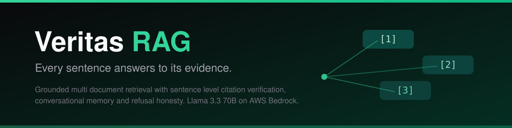
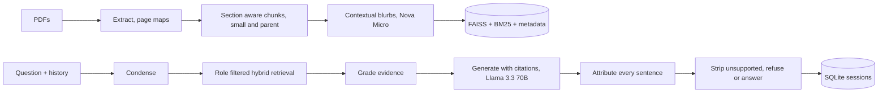

<p align="center">
  
</p>

<p align="center">
  <strong>Every sentence answers to its evidence.</strong><br>
  Upload multiple PDF reports, ask questions in natural language, and receive answers
  where each sentence is verified against the chunk it cites before you see it.
  When the documents do not contain the answer, the system refuses instead of guessing.
</p>

<p align="center">
  
  
  
  
  
  
</p>

<p align="center">
  <a href="docs/demo-script.md"><strong>Demo walkthrough</strong></a>
  &nbsp;&middot;&nbsp;
  <a href="evals/report.md">Evaluation report</a>
  &nbsp;&middot;&nbsp;
  <a href="docs/00-project-brief.md">Project brief</a>
  &nbsp;&middot;&nbsp;
  <a href="docs/README.md">Design docs</a>
</p>

---

Grounded multi document RAG with conversational memory and sentence level citation
verification. Ingestion is layout aware and idempotent, retrieval is hybrid (BM25 +
dense, fused with reciprocal rank, reranked by a local cross encoder), access rules
are enforced before scoring, and a LangGraph pipeline grades evidence, generates with
inline citations, then verifies every sentence against its cited chunk. Open source
Llama 3.3 70B on AWS Bedrock writes the answers; Nova Micro grades, rewrites and
judges. Models propose, code decides.

## The 30 second version

Ask "What was Apples total net sales in fiscal 2024?" over the ingested corpus: the
answer arrives as "Apple's total net sales in fiscal 2024 were $391,035 million [1]"
with the citation resolving to the consolidated financial statements, page 1. Ask
"Summarize that for an investor" next: the follow up resolves from persisted session
memory, no context restated. Ask about cricket: refused explicitly, because the
corpus does not contain it. Restrict the role to engineering and ask about net sales
again: denied, because the strongest evidence for that question sits in a finance
document the role cannot access.

## Architecture



## Measured results

Golden set evaluation, 30 questions across six categories, real providers
(Llama 3.3 70B generation, Nova Micro grading and judging), prompt v1.1.0:

| Metric | Result |
|---|---|
| Retrieval recall@5 | 0.818 (dense only baseline: 0.833) |
| Refusal accuracy | 8/8 |
| Permission accuracy | 4/4, zero evidence leaks |
| Draft support rate | 0.815, and delivered citation precision is 1.0 by construction |
| Attribution benchmark | precision 1.000, recall 1.000 over 20 labeled pairs |
| Latency | about 2.9 s per turn end to end |
| Cost | about 0.001 USD per answer, 0.037 USD for the whole evaluation |
| Tests | 58 passing, 92.7 percent coverage, strict mypy, ruff clean |

Every unsupported draft sentence is removed before delivery, so what reaches the
user is verified by construction; the support rate measures how much survives.
The full per case breakdown lives in [evals/report.md](evals/report.md).

## Honest limitations

- The golden set was authored by the same engineer who wrote the system; the
  attribution benchmark and refusal categories are measured, but a third party
  question set is the next credibility step.
- On the title hit metric, the dense only baseline roughly matches the hybrid
  pipeline; the fusion and rerank value shows in evidence ordering, and MRR and
  nDCG reporting is the next measurement upgrade.
- CPU rerank latency grows with corpus size; the interface accepts a hosted
  reranker as a configuration change.
- The corpus is small and public by design. Multi tenant scale out, OCR fallback
  and connector sync are specified in the production roadmap (docs/12) and
  deliberately out of scope here.
- One model leg is calibrated (Nova Micro grading, Llama 3.3 generation). Routing
  changes reopen the evaluation protocol with a fresh pre/post pair.
- AWS documents Llama 3.3 70B as legacy with EOL 2027-03-30; it is retained
  deliberately for this delivery window and the generator is a one line config
  change (docs/11).

## Quick start

```bash
make setup          # venv + pinned dependencies
make ingest         # build the hybrid index from data/corpus (needs AWS for blurbs)
make api            # FastAPI service on :8000
make console        # Next.js console on :3000 (npm install inside console first)
make eval           # offline evaluation smoke, no credentials
make eval-real      # full golden set over real providers
```

No AWS credentials are needed for `make test` or `make eval`; both run on
deterministic fake providers and fixture documents. The offline ingest variant is
`make ingest-offline`.

## Repository layout

```
app/            api, core, ingest, retrieval, graph, attribution, providers
evals/          golden set, attribution benchmark, runner, report
tests/          unit and integration, fixture PDFs built in code, zero network
console/        Next.js chat client with citations and a live trace panel
docs/           numbered engineering documents, control tables, what broke
data/           committed corpus (public reports), generated indexes and traces
.github/        ci.yml (push gates) and nightly.yml (full evaluation)
```

## Engineering documents

| # | Document | Contents |
|---|----------|----------|
| 00 | [Project brief](docs/00-project-brief.md) | Assignment verbatim, option rationale, hard constraints |
| 01 | [Problem statement](docs/01-problem-statement.md) | Why grounded retrieval matters |
| 02 | [Product requirements](docs/02-product-requirements.md) | Personas, requirements, non goals |
| 03 | [Architecture](docs/03-architecture.md) | Components, pipeline, model routing |
| 04 | [Data design](docs/04-data-design.md) | Corpus, chunking, schemas, index layout |
| 05 | [Retrieval design](docs/05-retrieval-design.md) | Hybrid search, fusion, rerank, filtering, cache |
| 06 | [Generation and grounding](docs/06-generation-and-grounding.md) | Citations, attribution, refusal, memory |
| 07 | [API specification](docs/07-api-specification.md) | Endpoints, streaming protocol, errors |
| 08 | [Security and privacy](docs/08-security-and-privacy.md) | Access control, audit, injection stance |
| 09 | [Evaluation design](docs/09-evaluation-design.md) | Golden set, metrics, gates |
| 10 | [Testing strategy](docs/10-testing-strategy.md) | Layers, stubs, coverage policy |
| 11 | [Technology stack](docs/11-tech-stack.md) | Libraries, verified model matrix, deprecation guards |
| 12 | [Roadmap](docs/12-roadmap.md) | Phase gated delivery and production scale out |

## Attribution and context

Built by Prakhar Shukla as a hiring assignment for Humanli.ai (ML and GenAI
Engineer, Jaipur) and as standalone portfolio material. Prior systems in the same
series: Sentinel (cross merchant fraud detection), Gatehouse (autonomous fraud
defense agent), TruthLayer (AI hallucination firewall).

License: [MIT](LICENSE)
