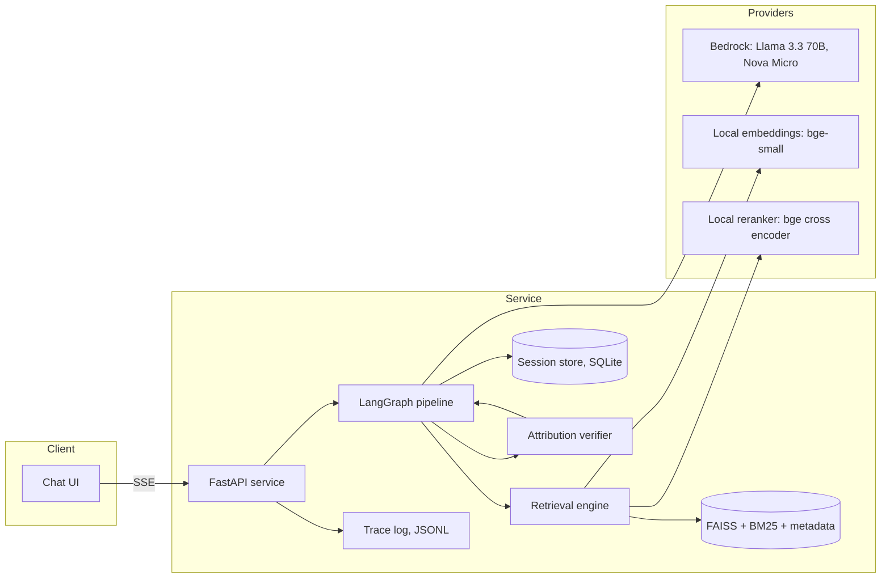
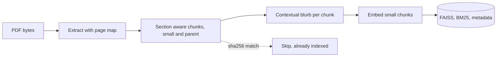

# 03. Architecture

## System overview

## Request lifecycle

1. The client sends the session id, role and question to the chat endpoint.
2. The condense node rewrites the question into a standalone form using session history, so "summarize that" becomes a self contained query.
3. The retrieval engine filters candidate chunks by role, then scores with dense and sparse search, fuses the results and reranks the survivors.
4. The grade node judges whether the surviving evidence is relevant to the question. Weak evidence short circuits to refusal.
5. The generate node drafts an answer with inline citations from the evidence blocks.
6. The attribution node splits the draft into sentences and verifies each against its cited chunk. Unsupported sentences are removed. If nothing survives, the request is refused.
7. Verified sentences, citations and source records stream to the client.
8. The trace writer records latency, token usage and verdicts for the request.

## Pipeline design

The pipeline is a LangGraph state graph, chosen over a linear chain because the flow branches: graded evidence can trigger a refusal path, attribution failure can trigger refusal, and the condense node depends on persisted history. State carries the condensed question, role, evidence blocks, draft sentences, verdicts and the final answer.

| Node | Responsibility | Model |
|---|---|---|
| condense | Rewrite question into standalone form from history | Nova Micro |
| retrieve | Role filtered hybrid search, fusion, rerank, parent expansion | local |
| grade | Judge evidence relevance, one call over all blocks | Nova Micro |
| generate | Draft grounded answer with citations | Llama 3.3 70B |
| attribute | Verify each sentence against its cited chunk | Nova Micro |
| finalize | Strip unsupported sentences, assemble sources, persist history | none, pure code |

## Model routing

Cheap models grade and judge; a strong open source model writes. This is deliberate: grading is high volume and low complexity, generation is low volume and high complexity.

| Role | Model | Provider | Notes |
|---|---|---|---|
| Rewrite, grade, judge | Amazon Nova Micro | Bedrock | fastest and cheapest verifier, access verified |
| Generation (default) | Meta Llama 3.3 70B | Bedrock, inference profile | open source model, matches deployment goal |
| Generation (quality option) | Amazon Nova Pro | Bedrock | alternative writer via config |
| Embeddings (default) | BAAI bge-small-en-v1.5 | local | zero cost, reproducible, no credentials needed |
| Embeddings (option) | Amazon Titan Embed Text v2 | Bedrock | 1024 dims, access verified |
| Reranking | BAAI bge-reranker-base | local | cross encoder on CPU; Cohere Rerank was evaluated but is not accessible on the target account |

All model identifiers live in configuration, never in code. Provider selection is environment driven, which is the deprecation guard described in doc 11.

## Ingestion pipeline

Extraction, chunking and indexing are described in doc 04. Ingestion is idempotent: a document whose content hash already exists in the index is skipped.

## Key decisions

| Decision | Rationale |
|---|---|
| LangGraph state graph | The flow branches on grading and attribution outcomes; a state graph makes those branches explicit and testable |
| Hybrid dense plus sparse | Dense search catches paraphrase, sparse search catches exact terms, identifiers and numbers; fusion beats either alone |
| Local reranker | Cross encoder precision without a marketplace dependency; runs on CPU at corpus scale |
| SQLite for sessions | Durable history that survives restarts with zero infrastructure |
| JSONL traces | Full request audit in a format any tool can read, no external observability dependency |
| Streamlit UI | Demonstrates the API honestly in one command, no frontend build step for an evaluator |
